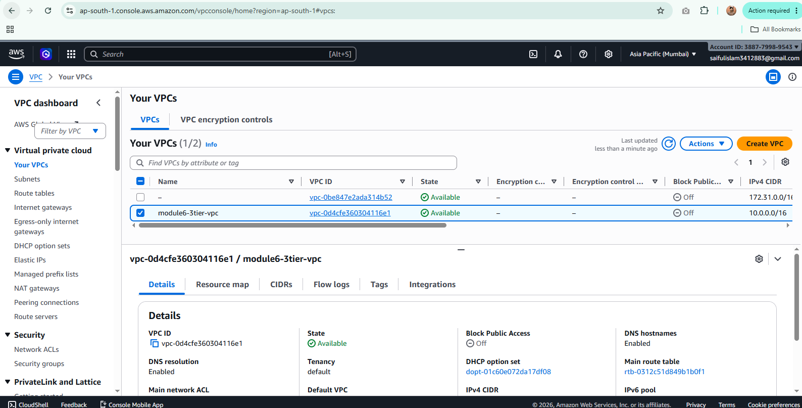
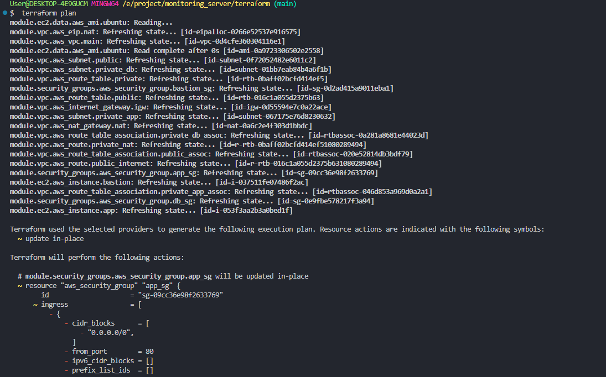
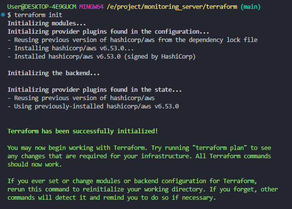
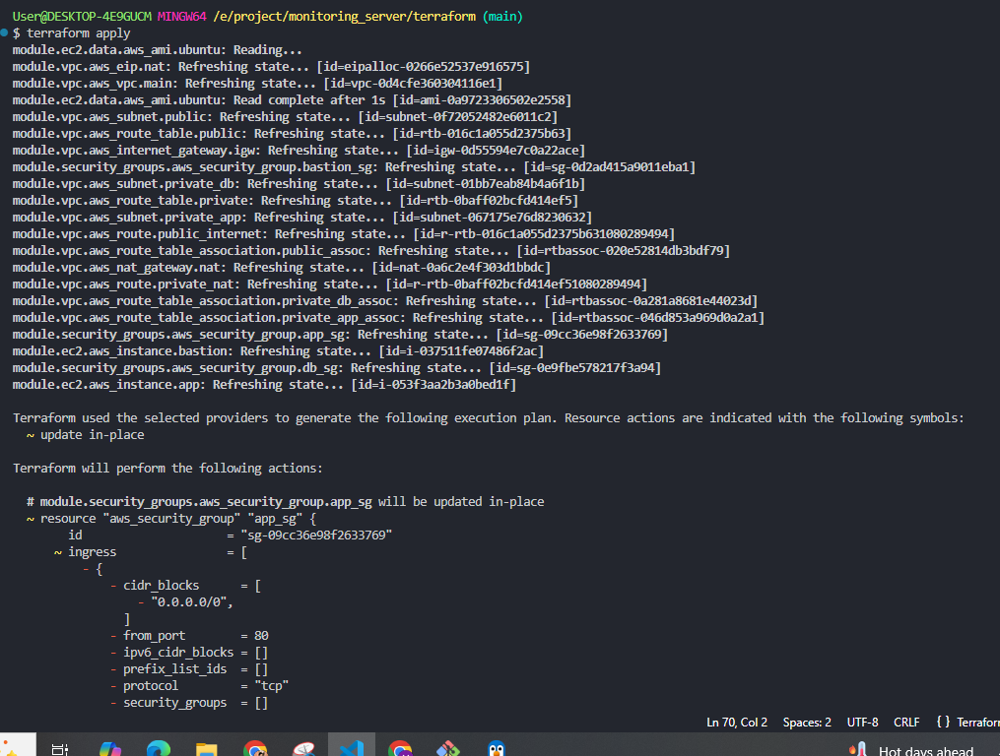
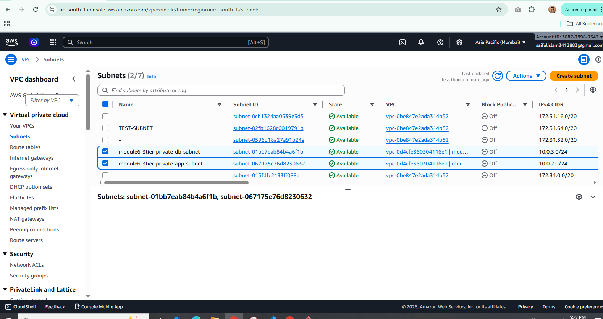
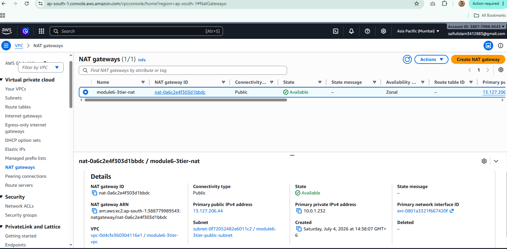
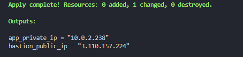
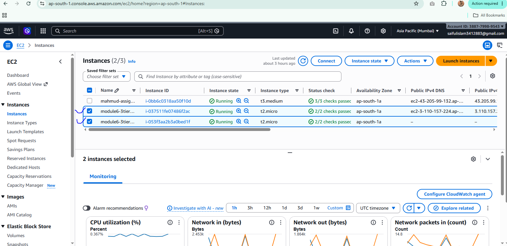

# Monitoring Server Terraform Infrastructure
This project provisions AWS resources using Terraform, including a VPC, subnet, route table, internet gateway, NAT gateway, and two EC2 instances.
Current outputs: app_private_ip = "10.0.2.238" and bastion_public_ip = "3.110.157.224"; RDS was not created because the AWS permissions were insufficient. GitHub Actions CI/CD is also configured for deployment to the EC2 instance.

## Screenshots

| Screenshot | Preview |
| --- | --- |
| vpc.PNG |  |
| TerroformPlan.PNG |  |
| terroformInit.PNG |  |
| TerroformApply.PNG |  |
| subnet.PNG |  |
| natGateways.PNG |  |
| Ips.PNG |  |
| Internat Gateway.PNG |  |
| ec2Instances.PNG |  |
